<div align="center">

  <!-- ═══════════════════════════════════════════════════════════════════ -->
  <!-- ⚡ HERO BANNER                                                      -->
  <!-- ═══════════════════════════════════════════════════════════════════ -->
  <a href="https://github.com/simply1git">
    
  </a>

  <br/><br/>

  <!-- ═══════════════════════════════════════════════════════════════════ -->
  <!-- 🌐 COMMAND DOCK                                                     -->
  <!-- ═══════════════════════════════════════════════════════════════════ -->
  <p align="center">
    <a href="https://samartha-hm.github.io">
      
    </a>
    <a href="https://linkedin.com/in/samartha-hm">
      
    </a>
    <a href="mailto:samarthahm@gmail.com">
      
    </a>
    <a href="https://www.youtube.com/@DreamBeatz">
      
    </a>
    
  </p>

</div>


<!-- ═══════════════════════════════════════════════════════════════════ -->
<!-- 01 // SYSTEM SPECIFICATION                                          -->
<!-- ═══════════════════════════════════════════════════════════════════ -->

### `01 // SYSTEM_MANIFEST.toml`

```toml
[architect]
name       = "Samartha Horabailu Manjunatha"
handle     = "@simply1git"
role       = "Full-Stack Systems Architect · AI & Embedded Hardware Engineer"
org        = "Core Team @ Experimind Labs"
location   = "Karnataka, IN"
philosophy = "I don't build demos — I ship end-to-end production systems from silicon to cloud."

[domains]
distributed_web  = ["Zero-Latency WebRTC/WebSockets", "High-Throughput FastAPI & Node.js", "Differential State Sync"]
ai_and_media     = ["Autonomous Multi-Modal Agents", "Lossless Video-Frame Cloud Storage", "Edge Computer Vision (OpenCV / MobileNetV2)"]
silicon_and_iot  = ["Multi-Layer PCB Design (KiCad)", "ESP32 / Raspberry Pi 5 Robotics", "4G/LTE Industrial Telemetry & OCPP"]
```


<!-- ═══════════════════════════════════════════════════════════════════ -->
<!-- 02 // DEPLOYED SOFTWARE & AI SYSTEMS (BENTO MATRIX)                 -->
<!-- ═══════════════════════════════════════════════════════════════════ -->

### `02 // DEPLOYED_SYSTEMS`

<table width="100%">
  <tr>
    <td width="50%" valign="top">
      <h4>
        <a href="https://github.com/simply1git/yotudrive">📹 YotuDrive</a>
        &nbsp;
        
      </h4>
      <p><b>Lossless Infinite Cloud Storage Engine</b> — Encodes arbitrary binary payloads into resilient, high-density video frame matrices to turn video streaming pipelines into zero-cost cloud storage.</p>
      <p><code>Python</code> <code>OpenCV</code> <code>FastAPI</code> <code>FFmpeg</code> <code>Binary-Codec</code></p>
    </td>
    <td width="50%" valign="top">
      <h4>
        <a href="https://github.com/simply1git/SyncPadIO">⚡ SyncPadIO</a>
        &nbsp;
        
      </h4>
      <p><b>Zero-Latency Collaborative Workspace</b> — Real-time markdown and code scratchpad powered by WebSocket room orchestration, differential state delta merging, and offline-first persistence.</p>
      <p><code>TypeScript</code> <code>React</code> <code>WebSockets</code> <code>Node.js</code></p>
    </td>
  </tr>
  <tr>
    <td width="50%" valign="top">
      <h4>
        <a href="https://github.com/simply1git/simplyytr">🤖 SimplyYTR</a>
        &nbsp;
        
      </h4>
      <p><b>Autonomous Media Synthesis Pipeline</b> — End-to-end content agent that ingests live trend signals, synthesizes scripts and neural voiceovers, composites dynamic reels, and schedules distribution.</p>
      <p><code>Python</code> <code>AI Pipelines</code> <code>FFmpeg</code> <code>REST APIs</code></p>
    </td>
    <td width="50%" valign="top">
      <h4>
        <a href="https://github.com/simply1git/watch-party-extension">🎬 Watch Party</a>
        &nbsp;
        
      </h4>
      <p><b>Sub-Millisecond Stream Synchronizer</b> — Browser extension engine delivering frame-accurate synchronized video playback across distributed peers with WebRTC voice/chat rooms.</p>
      <p><code>WebRTC</code> <code>WebExtensions</code> <code>Node.js</code> <code>Socket.io</code></p>
    </td>
  </tr>
  <tr>
    <td width="50%" valign="top">
      <h4>
        <a href="https://github.com/simply1git/toolspage">🛠️ ToolsPage</a>
        &nbsp;
        
      </h4>
      <p><b>Zero-Dependency Developer Swiss-Army Knife</b> — Client-side cryptographic hash engines, AST formatters, and binary encoders executing 100% in-browser via Web Crypto APIs.</p>
      <p><code>Vanilla JS</code> <code>Web Crypto API</code> <code>PWA</code> <code>Zero-Deps</code></p>
    </td>
    <td width="50%" valign="top">
      <h4>
        <a href="https://github.com/simply1git/Amarketer">📈 Amarketer</a>
        &nbsp;
        
      </h4>
      <p><b>Multi-Channel Growth & SEO Telemetry</b> — Automated analytics aggregator providing real-time performance tracking, technical SEO auditing, and conversion intelligence.</p>
      <p><code>Python</code> <code>FastAPI</code> <code>Data Pipelines</code> <code>Analytics</code></p>
    </td>
  </tr>
</table>


<!-- ═══════════════════════════════════════════════════════════════════ -->
<!-- 03 // SILICON, EDGE AI & ROBOTICS ENGINEERING                       -->
<!-- ═══════════════════════════════════════════════════════════════════ -->

### `03 // SILICON_&_EDGE_SYSTEMS`

<table width="100%">
  <tr>
    <td width="33%" valign="top">
      <b>🚜 4WD Autonomous Crop Robot</b><br/>
      <sub>Dual-compute architecture (<b>Raspberry Pi 5 + Arduino Mega</b>) driving high-current BTS7960 H-bridges with a live React control & telemetry cockpit.</sub>
    </td>
    <td width="33%" valign="top">
      <b>📡 4G/LTE Water Quality Node</b><br/>
      <sub>Custom hardware with <b>sensor phase multiplexing</b> to eliminate cross-probe interference, streaming continuous industrial telemetry to <b>AWS EC2</b>.</sub>
    </td>
    <td width="33%" valign="top">
      <b>🧠 Edge-AI Waste Classifier & IoT Kits</b><br/>
      <sub><b>ESP32-CAM + MobileNetV2</b> real-time sorting vision pipeline, plus commercial PCB layout (KiCad) for educational IoT kits at Experimind Labs.</sub>
    </td>
  </tr>
</table>


<!-- ═══════════════════════════════════════════════════════════════════ -->
<!-- 04 // TECH ARSENAL                                                  -->
<!-- ═══════════════════════════════════════════════════════════════════ -->

### `04 // TECH_STACK`

<div align="center">

| Layer | Core Technologies |
| :--- | :--- |
| **Languages** |  |
| **Full-Stack & APIs** |  |
| **AI, Vision & Data** |  |
| **Hardware & Infra** |  |

</div>


<!-- ═══════════════════════════════════════════════════════════════════ -->
<!-- 05 // TELEMETRY & CONTRIBUTION MATRIX                               -->
<!-- ═══════════════════════════════════════════════════════════════════ -->

### `05 // GITHUB_TELEMETRY`

<div align="center">

  <a href="https://github.com/simply1git">
    
  </a>
  <a href="https://github.com/simply1git">
    
  </a>

  <br/><br/>

  <a href="https://github.com/simply1git">
    
  </a>

  <br/><br/>

  <picture>
    <source media="(prefers-color-scheme: dark)" srcset="https://raw.githubusercontent.com/simply1git/simply1git/output/github-contribution-grid-snake-dark.svg" />
    <source media="(prefers-color-scheme: light)" srcset="https://raw.githubusercontent.com/simply1git/simply1git/output/github-contribution-grid-snake.svg" />
    
  </picture>

</div>

<div align="center">
  <a href="https://github.com/simply1git">
    
  </a>
</div>
